<!-- Header -->


<p align="center">
  
</p>

<p align="center">
  
</p>

<p align="center">
  
  <a href="mailto:ritikrajj07@gmail.com"></a>
</p>

---

## 👨‍💻 About Me

I'm a passionate developer who loves turning ideas into real-world products with modern web technologies. I enjoy the full journey, from crafting clean UIs to designing the systems behind them.

```js
const ritik = {
  role:        "Software Developer",
  location:    "India 🇮🇳",
  exploring:   ["MERN Stack", "PHP", "Blockchain", "Backend Systems"],
  currently:   "Building a Blockchain-based Patient Data Security System",
  foundations: ["DSA", "Operating Systems", "DBMS", "OOP"],
  goal:        "Software Engineering roles 🎯",
  funFact:     "I solve DSA problems for fun ⚡",
};
```

---

## 🏆 Highlights

| | |
|---|---|
| 🥇 **Hackathon Project** | Blockchain-based Patient Data Security System |
| 📘 **Strong CS Foundation** | DSA · OS · DBMS · OOP |
| ⚡ **Competitive Programming** | Active on Codeforces & LeetCode |
| 🎯 **Next Step** | Preparing for Software Engineering roles |

---

## 🛠️ Tech Stack

**Languages**


**Frontend**


**Backend & Database**


**Tools & Hardware**


---

## 🚀 Featured Project

### 🔐 Blockchain-based Patient Data Security System
> A hackathon project that secures patient medical records using blockchain, keeping data tamper-proof and access patient-controlled.

<!-- Replace the link below with your project repo -->
[](https://github.com/ritik245)

---

## 🌍 Open Source Contributions

<p>
  <a href="https://github.com/search?q=is%3Apr+author%3Aritik245+-user%3Aritik245+is%3Amerged&type=pullrequests"></a>
  <a href="https://github.com/search?q=is%3Apr+author%3Aritik245+-user%3Aritik245+is%3Aopen&type=pullrequests"></a>
  <a href="https://github.com/search?q=is%3Aissue+author%3Aritik245+-user%3Aritik245&type=issues"></a>
</p>

**Recent pull requests to other projects** *(updated automatically every day)*

<!--OSS:START-->
| Repository | Pull Request | Status |
|---|---|---|
| [dotnet/dotnet-api-docs](https://github.com/dotnet/dotnet-api-docs) | [Update Process docs for UseShellExecute default of false](https://github.com/dotnet/dotnet-api-docs/pull/13167) | 🟢 Open |
| [dotnet/dotnet-api-docs](https://github.com/dotnet/dotnet-api-docs) | [Remove outdated UseShellExecute requirement from ProcessWindowStyle.H…](https://github.com/dotnet/dotnet-api-docs/pull/13166) | 🟢 Open |
<!--OSS:END-->

---

## 🧠 Competitive Programming

<p align="center">
  <a href="https://leetcode.com/ritikkraj07">
    
  </a>
</p>

<p align="center">
  <a href="https://codeforces.com/profile/ritikk_07"></a>
  <a href="https://leetcode.com/ritikkraj07"></a>
</p>

---

## 🤝 Connect With Me

<p align="center">
  <a href="mailto:ritikrajj07@gmail.com"></a>
  <a href="https://codeforces.com/profile/ritikk_07"></a>
  <a href="https://leetcode.com/ritikkraj07"></a>
</p>


